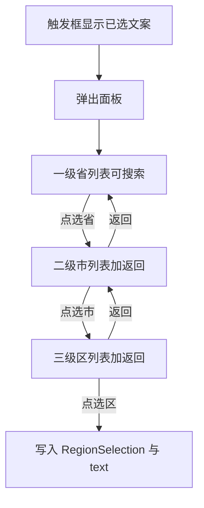

# 56 民族全量 + 省市区三级联动技术方案

> 状态：已确认并实现（2026-09-24）。

## 目标

1. **民族**：官方 56 个全部可搜可选，**去掉「其他」**（对应你截图里当前残缺下拉）。
2. **地区**：现居城市、籍贯、户口所在地、出生地等改为 **省 → 市 → 区** 三级选择；选省后出市、选市后出区；支持 **返回上一级**；区划写全（大陆完整区县树）。
3. 不引入 React；继续 WXT + 原生 TS；数据本地打包，运行时不依赖外网。

---

## 一、民族全量

文件：[`src/shared/catalogs/enums.ts`](src/shared/catalogs/enums.ts)

- 重写 `ETHNICITY_OPTIONS` 为 56 族正式名称（汉族 … 珞巴族）。
- `code` 用稳定拼音码，`labelZh` 用官方中文名。
- **删除** `{ code: 'other', labelZh: '其他' }`。
- 仍走现有可搜索下拉（56 项足够搜）。
- 旧档案若存了「其他」或未知值：界面可暂时显示原文；新选择只能从 56 族中选。

---

## 二、省市区：数据与选型（已定）

| 项 | 决定 |
|----|------|
| 范围 | 大陆省/直辖市/自治区 + 地市 + 区县（含直辖市下辖区） |
| 运行时 | 本地 JSON 打进扩展，不调在线 API |
| 产物路径 | `public/data/china-pca.json`（构建进扩展根目录 `/data/china-pca.json`） |
| 生成 | `scripts/build-china-pca.mjs` 从开源区划数据集生成可重复构建的树 |
| 加载 | Options **首次打开地区控件**再 `fetch` 并内存缓存，避免 Popup 冷启动变重 |
| 港澳台 | 作省级节点；有下级则继续选，无下级则选到该级即可确认 |

节点形状：

```ts
type RegionNode = { code: string; name: string; children?: RegionNode[] };
```

---

## 三、存档字段（兼容旧字符串）

[`BasicInfo`](src/shared/types/profile.ts)：

- 字符串主字段（喂 LLM / 启发式 / 兼容）：
  - `currentCity`（硬必填）
  - `nativePlace`（硬必填）
  - `hukouLocation`、`birthPlace`
- 新增结构化（回显三级）：

```ts
interface RegionSelection {
  provinceCode: string;
  provinceName: string;
  cityCode: string;
  cityName: string;
  districtCode: string;
  districtName: string;
  /** 展示：「广东省 / 深圳市 / 南山区」 */
  text: string;
}
```

对应：`currentCityRegion`、`nativePlaceRegion`、`hukouLocationRegion`、`birthPlaceRegion`。

归一化：有 `*Region` 时用 `text` 回填字符串；仅有旧字符串时控件显示原文，打开选择器可重选。

求职意向：

- `workCity`：单点三级选择。
- `expectedCities`：可多次选三级结果，用顿号拼接成串。

---

## 四、UI：Drill-down 三级选择器

新建 `src/entrypoints/options/regionCascader.ts`：



- 触发：只读输入 +「选择」；必填保留珊瑚 `*`。
- 顶栏：面包屑 + **返回上一级** + 关闭。
- 当前级可搜索；列表 **无「其他」**。
- 选到区（或无下级时选到市/省）后写入并关闭。
- 样式沿用躺投青绿品牌。

Options 挂载点：现居城市、籍贯、户口所在地、出生地、工作城市、期望城市；教育/经历里的城市复用同一组件。

样例表：把 `china-pca.json` 副本放到 `fixtures/data/`，便于本地 `serve` 验收；或样例页仅展示文案、重点在 Options。

---

## 五、LLM / 启发式

- 城市类继续用 `text`（省/市/区）喂模型。
- `localHeuristics` 仍读 `currentCity` 字符串，逻辑不变。

---

## 六、实现顺序（同意后执行）

1. 生成 `china-pca.json` + 构建脚本；`public` + `fixtures` 副本。
2. 56 民族枚举，去「其他」。
3. 实现 Cascader（加载缓存、Drill-down、搜索、返回）。
4. 类型 / normalize + Options 挂载。
5. 样例对齐 + `npm run build`。

不自动写单测；手测：搜「土家」→ 土家族；选「广东→深圳→南山」保存回显；返回上一级可改市。

---

## 请确认

回复 **同意**（或指出要改的点，例如：是否必须含港澳台、期望城市是否要多选）后开始编程。
